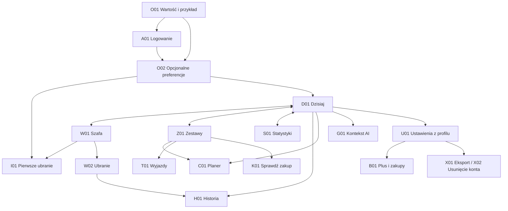

# T002 — Projekt ekranów i przepływów

Wersja 1.0, 1 listopada 2026. Projekt funkcjonalny o niskiej szczegółowości,
do implementacji natywnej w SwiftUI. Źródła: [SPEC](../../SPEC.md) §2–8
oraz [T001](T001-specyfikacja-produktu.md). Towarzysząca
[macierz stanów](T002-stany-i-odbior.md) jest integralną częścią projektu.

Zakres: wyłącznie T002. To projekt, nie działająca aplikacja, pomiar użyteczności
ani zrzuty z buildu. T003 dobierze kolory, typografię, komponenty i String Catalog;
T004 sprawdzi prototyp z testerami. Brak udokumentowanej akceptacji D01 w T001
pozostaje otwartą zależnością finalnego zakresu. Projekt można ocenić teraz;
nie oznacza to zatwierdzenia oferty przez właściciela.

## 1. Nawigacja i konwencje ekranów



Cztery stale nazwane zakładki: Dzisiaj, Szafa, Zestawy, Statystyki. Każda ma
własny stos nawigacji i zachowuje pozycję listy, filtry oraz wybraną datę.
Profil w pasku każdej zakładki otwiera U01. Szczegóły otwierają się w stosie;
formularze, selektory dat/rzeczy, oferta i zgody jako arkusze z „Anuluj” lub
„Zamknij”. Back i gest systemowy wracają do rzeczywistego źródła, np. ze
szczegółu ubrania do rankingu, nie zawsze do Szafy. Deep link tworzy stos
rodzica (plan → Dzisiaj, ubranie → Szafa); po logowaniu wraca do celu, jeśli
nadal istnieje i należy do użytkownika. W przeciwnym razie pokazuje informację
i przejście do rodzica bez ujawniania obcych danych.

Każdy opis układu poniżej czyta się od góry do dołu: pasek → zawartość → akcje.
Listy i formularze przewijają się. Główna akcja jest w bezpiecznym obszarze,
osiągalna po powiększeniu tekstu i przy klawiaturze; nie przykrywa treści.
Przykładowe ramki określają hierarchię, nie sztywne wysokości.

```text
D01 Dzisiaj                  W01 Szafa                    G02 Propozycja
┌────────────────────────┐  ┌────────────────────────┐  ┌────────────────────────┐
│ Dzisiaj        Profil  │  │ Szafa       +   Profil │  │ ‹ Wstecz    Propozycje  │
│ Data · Kalendarz       │  │ Szukaj…                │  │ 1 z liczby wyników     │
│ Stan synchronizacji    │  │ Filtry · Sortuj        │  │ Kolaż własnych ubrań   │
│ Plan: kolaż i nazwa    │  │ Liczba wyników         │  │ Brak? → komunikat      │
│ [Noszę dzisiaj]        │  │ Zdjęcie    Zdjęcie     │  │ Krótkie uzasadnienie   │
│ Zapisane dzisiaj →     │  │ Nazwa      Nazwa       │  │ Elementy → Zamień      │
│ [Zaproponuj zestawy]   │  │ Status     Status      │  │ [Zapisz] [Zaplanuj]    │
│ Historia →            │  │ …                      │  │ [Noszę dzisiaj]         │
│ 4 zakładki            │  │ 4 zakładki             │  │ Lubię / Nie lubię      │
└────────────────────────┘  └────────────────────────┘  └────────────────────────┘

I03 Formularz ubrania        H02 Zdarzenie noszenia        B01 Oferta
┌────────────────────────┐  ┌────────────────────────┐  ┌────────────────────────┐
│ Anuluj    Nowa rzecz   │  │ ‹ Historia    Edytuj   │  │ Zamknij           Plus │
│ Zdjęcie · Zmień kadr   │  │ Lokalna data noszenia  │  │ Korzyści i ograniczenia│
│ Oryginał / Bez tła     │  │ Zdjęcia zapisanych     │  │ Miesiąc / Rok          │
│ Kategoria* · Kolory    │  │ w zdarzeniu rzeczy    │  │ Cena i okres: StoreKit │
│ Wzór · Sezon · Styl    │  │ Źródło zestawu         │  │ Warunki odnawiania     │
│ Sugestie AI: popraw    │  │ Stan synchronizacji    │  │ Trial tylko uprawnionym│
│ Cena PLN / Nieznana    │  │ [Cofnij to noszenie]   │  │ [Kup wybrany wariant]  │
│ Marka · Data (opcje)   │  │ Pozostałe noszenia     │  │ Przywróć zakupy        │
│ [Zapisz ubranie]       │  │ tego dnia →            │  │ Warunki · Prywatność   │
└────────────────────────┘  └────────────────────────┘  └────────────────────────┘
```

Nie używamy koloru jako jedynego nośnika statusu. Zdjęcia mają etykiety, kolaż
ma dostępną tekstową listę rzeczy; akcje nie wymagają gestów. VoiceOver czyta
nagłówek, status, treść, akcje. Dynamic Type dopuszcza jedną kolumnę zamiast
siatki, zawijanie etykiet i pionowy układ przycisków. Reduce Motion usuwa
niekonieczne animacje. Błędy pól są obok pól i w podsumowaniu z przeniesieniem
fokusu. Projekt obowiązuje w PL/EN i obu motywach; finalne tłumaczenia i wizualne
parametry należą do T003. Wszystkie liczby przykładowe są danymi demonstracyjnymi.

## 2. Onboarding, konto i uprawnienia — F01, F02

| Ekran | Układ i działania | Przejście / reguła |
| --- | --- | --- |
| O01 Wartość | Tytuł „Twoja szafa, gotowe zestawy”; demonstracyjny kolaż oznaczony „Przykład”; korzyści: własne rzeczy, plan, CPW; „Zobacz przykład”, „Zacznij”, „Mam konto”, „Pomiń wprowadzenie” | Przykład otwiera lokalny podgląd z powrotem, bez tworzenia rzeczy i noszeń. Zacznij → A01; pominięcie → pusta D01 z możliwością logowania i dodania lokalnego draftu |
| A01 Konto | Apple; email; objaśnienie synchronizacji; polityki; Zamknij | Email → A02. Nie wymagamy telefonu, płci ani zdjęcia sylwetki. Oglądanie przykładu i lokalny draft nie wymagają konta; synchronizacja wymaga sesji |
| A02 Sprawdź email | Wpisany adres, instrukcja otwarcia linku, „Wyślij ponownie” z odliczaniem wynikającym z odpowiedzi, „Zmień email” | Powrót z linku wznawia zapisany cel. Wygasły/użyty link → nowy link; błąd nie usuwa draftu. Private relay nie wymaga zwykłego adresu. Łączenie tożsamości ma osobne potwierdzenie obu tożsamości; nigdy automatycznie po emailu |
| O02 Preferencje | Opcjonalne style, kolory, wykluczenia; „Dalej”, „Pomiń” | O03; zapis edytowalny w U02; bez obowiązkowej płci, rozmiaru, sylwetki |
| O03 Pierwsza rzecz | Krótkie objaśnienie; „Dodaj zdjęcia”, „Zrób zdjęcie”, „Później” | I01 lub D01. Wiele zdjęć oznacza osobne drafty |
| A03 Sesja wygasła | Informacja nad zachowaną treścią; „Zaloguj ponownie”; bez wyświetlania cudzych danych | Logowanie do tego samego konta wznawia operację. Inne konto nie przejmuje draftów/outboxu poprzedniego konta |
| U03 Zgoda AI | Rzeczywisty odbiorca, zakres danych (wybrane zdjęcia/metadane/uwagi), cel, retencja, wersja zgody; „Zgadzam się”, „Teraz nie” | Przed pierwszą wysyłką, powrót do jej źródła. Brak zatwierdzonych danych odbiorcy D05/D06 blokuje wysyłkę, nie ręczny zapis. Cofnięcie zgody w U03 blokuje także niewysłaną kolejkę |

Aparat pytamy dopiero po „Zrób zdjęcie”; po odmowie PhotosPicker i opcja
przejścia do ustawień iOS. PhotosPicker nie wymaga szerokiego dostępu do
biblioteki. Lokalizację pytamy dopiero przy „Użyj lokalizacji” w G01/U02;
miasto ręczne jest równorzędne. Powiadomienia dopiero po świadomym włączeniu
przypomnienia w C02/U04. Odmowa nie blokuje pozostałych funkcji.

## 3. Import i szafa — F03–F05

| Ekran | Układ i działania | Przejście / reguła |
| --- | --- | --- |
| I01 Źródło i kolejka | Zdjęcia / aparat; lista miniatur z osobnymi stanami: draft, w obróbce, do poprawy, zapisany, błąd; „Otwórz draft”, „Dodaj kolejne” | Każde zdjęcie → osobny I02. Nie wycinamy wielu rzeczy z jednego zdjęcia. Błąd jednego draftu nie zatrzymuje reszty; można usunąć tylko wybrany draft |
| I02 Kadr i tło | Podgląd, kadr, obrót, „Usuń tło”, przełącznik oryginał/wynik; „Dalej”, „Użyj oryginału” | I03; anulowanie kadrowania przywraca poprzedni kadr. Awaria segmentacji nie blokuje dalszej pracy |
| I03 Dane rzeczy | Zdjęcie; wymagana kategoria z wyborem „Inne”; kolory, wzór, sezony, formalność; sugestie AI oznaczone i edytowalne; cena PLN lub „Nie znam ceny”, marka, data zakupu opcjonalne; dostępność; „Zapisz” | AI nie uzupełnia ceny, daty ani marki. Cena 0 jest odrębna od nieznanej; walidacja nieujemnych groszy bez float. Brak AI → ten sam formularz ręczny. Zapis → W02 lub następny draft z kolejki; lista pokazuje wynik |
| I04 Możliwy duplikat | Miniatury nowej i istniejącej rzeczy; „Zobacz istniejącą”, „Zapisz mimo to”, „Wróć do draftu” | Ostrzeżenie nie scala i nie blokuje świadomego zapisu |
| W01 Szafa | Szukaj, filtry: kategoria, kolor, sezon, dostępność, archiwum; sortowanie; liczba wyników; siatka zdjęć/nazw/statusów; „+” | W02; filtry jako arkusz „Zastosuj/Wyczyść/Anuluj”. Domyślnie aktywne rzeczy; archiwum jawnie dostępne. Paginacja zachowuje istniejące wyniki |
| W02 Szczegóły | Zdjęcia oryginał/oczyszczone; nazwa/kategoria; cena PLN; CPW lifetime i dni; dostępność; sekcja historii; „Edytuj”, „Dodaj noszenie”, menu Archiwizuj/Usuń | Edycja → I03 z zachowaniem ID. Dostępność available/laundry/unavailable jest osobnym wyborem od archiwizacji. Archiwum zachowuje historię i ma „Przywróć” |
| W03 Usuń trwale | Nazwa i miniatura; wyjaśnienie usunięcia zdjęć/relacji i możliwej zmiany statystyk; „Anuluj”, „Usuń trwale” | Brak obietnicy cofnięcia po wykonaniu; po potwierdzeniu W01. Offline stan „Usunięcie oczekuje na synchronizację”; tombstone blokuje stare edycje |
| Y01 Synchronizacja i konflikt | Status: lokalnie zapisane / oczekuje / błąd; dla konfliktu dwie wersje z różnicami pól, podgląd wyboru i „Zapisz rozstrzygnięcie” | Ten sam rekord nie jest po cichu nadpisywany; ponowny konflikt odświeża porównanie. Usunięty rekord → wyjaśnienie i powrót, bez opcji przywrócenia starą edycją |

Wyjście z brudnego formularza: „Zachowaj draft”, „Odrzuć zmiany”, „Kontynuuj
edycję”. Draft zdjęcia pozostaje lokalny do synchronizacji. Zapis lokalny ma
status oczekiwania, nie komunikat o zakończonym uploadzie. Po timeout sprawdzamy
status tego samego identyfikatora operacji; wielokrotne naciśnięcie Zapisz nie
tworzy kopii. Wylogowanie wymaga ostrzeżenia o lokalnych danych jeszcze
niewysłanych: „Wróć i zsynchronizuj” albo „Wyloguj i usuń lokalne dane”.

## 4. Dzisiaj, AI i zestawy — F06–F08

| Ekran | Układ i działania | Przejście / reguła |
| --- | --- | --- |
| D01 Dzisiaj | Data i kalendarz; plan na dziś; zapisane noszenia; „Zaproponuj zestawy”; skrót historii | Plan bez automatycznego noszenia. „Noszę dzisiaj” → H03 z podglądem rzeczy |
| G01 Kontekst | Okazja; miasto i pogoda z czasem aktualizacji lub ręczna temperatura; opcjonalne preferencje/uwagi; liczba 1–10, domyślnie 3; przypięta rzecz; stan zgody i limitu; „Zaproponuj” | U03 gdy brak zgody; G02 po zleceniu. Gdy limit nieznany, nie obiecujemy dostępnej puli. Wykluczenia i dostępność są wiążące |
| G02 Zadanie i wyniki | Stan kolejka/analiza/gotowe/błąd; możliwość opuszczenia ekranu; po zakończeniu karty z kolażem realnych rzeczy, krótkim uzasadnieniem, listą elementów i braków | Ponowne wejście odczytuje istniejące zadanie. Licznik faktycznych wyników, np. „2 propozycje; brakuje butów”, bez zmyślonych rzeczy. Kompletność: top+dół+buty lub sukienka/kombinezon+buty. Niekompletność zawsze opisana |
| G03 Karta i zamiana | „Zapisz zestaw”, „Zaplanuj”, „Noszę dzisiaj”, „Zamień” przy rzeczy, Lubię/Nie lubię z opcjonalnym powodem | Zamiana → lista dostępnych rzeczy lub AI; reszta zestawu pozostaje. Zapis ponownie sprawdza własność i dostępność; zmiana szafy → wskaż problem i wybierz zamiennik. Feedback nie zapisuje noszenia |
| Z01 Kolekcja | Wszystkie/Ulubione; wyszukiwanie; kolaże; „Utwórz ręcznie”; skróty Planer/Wyjazdy/Sprawdź zakup | Z02 lub Z03. Pusty stan pozwala tworzyć ręcznie bez AI |
| Z02 Kreator | Nazwa, sloty kategorii, selektor rzeczy z filtrami; podgląd kolażu; wskaźnik kompletności; „Zapisz” | Można zapisać niekompletny ręczny zestaw z jawnym brakiem. Zamiana/usuń element nie zmienia reszty. Wyjście pyta o niezapisane zmiany |
| Z03 Szczegóły zestawu | Kolaż i lista, ulubiony, Edytuj, Zaplanuj, Noszę dzisiaj, Udostępnij, Usuń | Edycja nie zmienia historycznych H02. Usunięcie zestawu nie usuwa noszeń; pokazuje wpływ na związane plany przed potwierdzeniem |

Nie wysyłamy nowego żądania AI automatycznie po niejednoznacznym timeout.
Pokazujemy „Sprawdzamy status”; powtórzenie jest świadome po ustaleniu wyniku
poprzedniego zadania. Limit, awaria i wycofanie zgody pozostawiają kreator ręczny.
Zamknięcie widoku postępu nie obiecuje anulowania wysłanej analizy.

## 5. Historia, noszenie i CPW — F09, F10

| Ekran | Układ i działania | Przejście / reguła |
| --- | --- | --- |
| H01 Historia | Kalendarz/lista; wybrana data; zdarzenia z kolażami i statusem synchronizacji; „Dodaj noszenie” | Dla przyszłej daty „Zaplanuj” → C02 zamiast zapisu noszenia. Źródło: D01, W02 (filtr ubrania), S01 |
| H02 Zdarzenie | Lokalny dzień worn_on, historyczna lista rzeczy, źródło zestawu, Edytuj/Cofnij | Edycja daty/listy atomowa. Zmiana strefy urządzenia nie przesuwa daty historycznej. Cofnij pyta o to zdarzenie; wyjaśnia, że inne zdarzenie tego dnia może nadal liczyć tę samą rzecz |
| H03 Potwierdź noszenie | Dzień (domyślnie dziś), wybrane rzeczy, „Zapisz noszenie”, „Anuluj” | Podgląd przed zapisem także ze skrótu/widgetu. Dwa zdarzenia tego dnia mogą współdzielić rzecz; komunikat „Ta rzecz już liczy się w tym dniu”. Retry tej samej operacji nie dodaje nowego zdarzenia |
| H04 Estymacja | Osobna liczba wcześniejszych noszeń, data początku dziennika; objaśnienie szacunku; „Zapisz estymację” | Nie tworzy fikcyjnych dat. Konflikt ze starszą historią lub przesunięciem granicy → porównanie zakresów i wybór: popraw estymację/granicę albo anuluj zmianę; nie sumujemy nakładającej się historii bez rozstrzygnięcia |
| H05 Szczegóły CPW (z W02/S01) | Cena, unikalne dni lifetime, osobno estymacja i granica, wynik i wyjaśnienie; „Edytuj cenę”, „Historia” | 800 zł / 100 dni = 8 zł; cena 0 przy dniach = 0 zł; cena nieznana → „Brak ceny”; znana cena i 0 dni → „Jeszcze nienoszone”. Przy obu brakach oba objaśnienia. Nie pokazujemy 0 zł jako braku danych |

Noszenie liczy ubranie raz na lokalny dzień, niezależnie od liczby zdarzeń;
cofnięcie jednego nie usuwa użycia z innego. Zapis, edycja i cofnięcie mają
wspólny wzorzec operacji atomowej i idempotentnej. Cena jest w groszach,
zaokrąglenie tylko w prezentacji. Estymowane CPW ma widoczną etykietę
„Z estymacją wcześniejszych noszeń”; granica oddziela estymację od późniejszej
historii. Zmiana ceny zmienia wynik, nie noszenia.

## 6. Planer i narzędzia — F11–F15

| Ekran | Układ i działania | Przejście / reguła |
| --- | --- | --- |
| C01 Planer | Kalendarz i lista dnia z etykietami „Plan” / „Zapisane noszenie”; „Dodaj plan”; wejście z D01/Z01 | Przyszłe plany nie zwiększają dni ani CPW; nadejście daty też nie zapisuje noszenia |
| C02 Plan | Data, zestaw lub ręczny wybór rzeczy, opcjonalne przypomnienie; Zapisz/Przenieś/Usuń | Po „Noszę dzisiaj” H03; niezrealizowany plan pozostaje planem. Przeniesienie zmienia datę planu i przypomnienie, nie historię |
| T01 Wyjazdy | Lista nazw, miejsc i dat; „Nowy wyjazd”; dostęp do istniejących po wygaśnięciu Plus | T02. Tworzenie według proponowanej oferty T001/D01, bez ukrywania zapisów za paywallem |
| T02 Plan wyjazdu | Miejsce, daty od/do, okazje, ograniczenie liczby rzeczy; „Zbuduj plan”; lista unikalnych rzeczy i zestawów per dzień; braki i ręczna korekta | T03; niemożliwe ograniczenia → wyjaśnij braki, pozwól zmienić limit/dane. Brak rzeczy nie prowadzi do wymyślania produktów |
| T03 Pakowanie | Checklista unikalnych rzeczy z miniaturami i licznikiem spakowanych, plan dni; Edytuj/Udostępnij kolaż/Usuń wyjazd | Zaznaczenie „Spakowane” nie zapisuje noszenia. Zmiana rzeczy w planie aktualizuje checklistę i pokazuje różnicę |
| K01 Kandydat zakupu | Tymczasowe zdjęcie/kadr, „Sprawdź dopasowanie”; wyjaśnienie „Jeszcze nie należy do Twojej szafy” | K02; kandydat nie trafia do wartości szafy, AI dla posiadanych rzeczy ani CPW |
| K02 Wynik zakupu | Dopasowania z własnymi rzeczami, braki, „Kupiłem — dodaj do szafy”, „Usuń kandydata” | Potwierdzenie → I03 z ręczną ceną/datą/marką; dopiero zapis tworzy posiadaną rzecz. Bez oceny ciała ani fotorealistycznej przymiarki |
| N01 Przypomnienia | Włącznik opt-in, godziny ciszy, typ plan/noszenie, godzina; stan zgody systemowej | Odmowa → instrukcja ustawień iOS, nie powtarzające się prośby. Tap powiadomienia otwiera plan/H03, nic nie zapisuje automatycznie |
| N02 Widget | Minimalna data i plan/kolaż tylko świadomie skonfigurowanej zawartości; „Otwórz”, skrót noszenia | Skrót → H03 w aplikacji. Brak sesji → neutralny „Otwórz aplikację”; logout usuwa cache widgetu |
| E01 Udostępnij kolaż | Podgląd wybranego kolażu, jawny wybór podpisów, „Udostępnij” → systemowy share sheet | Tylko wybrany kolaż; bez historii, cen i identyfikatorów konta domyślnie. Anulowanie share sheet wraca do podglądu; nie twierdzimy, że odbiorca otrzymał plik |

## 7. Statystyki — F16

S01: pasek „Statystyki” i Profil → filtr okresu aktywności → wartość znanych
cen w PLN i liczba brakujących cen → rankingi noszeń w okresie → ranking
„CPW — całe życie” → „Nigdy nienoszone” → „Nienoszone od 90 dni” → lista S02.
Każda karta otwiera listę rzeczy, a rzecz W02/H05. Nie sumujemy CPW rzeczy jako
CPW całej szafy. Przy zmianie filtra podpis CPW lifetime pozostaje; wartość
szafy nie udaje wartości zakupów w okresie. Jawny zakres: aktywne/archiwalne/
wszystkie; etykieta przy wynikach mówi, które rzeczy uwzględniono.

S02: nazwa segmentu, kryterium i licznik → miniatura, data dodania, ostatnie
noszenie lub „Nigdy”, cena/CPW z brakami → „Zachowaj”, „Archiwizuj”,
„Przypomnij zestaw”. Reguła 90 dni uwzględnia datę dodania: nowa rzecz bez noszeń
nie jest prezentowana jako zaniedbana od 90 dni. Estymacje mają osobne oznaczenie,
nie wypełniają aktywności fikcyjnymi datami. Brak danych nie generuje porad
opartych na domniemanych oszczędnościach ani twierdzeń ekologicznych.

## 8. Płatności — F17

B01 (ramka w §1): oferta dostępna z U01 lub świadomie wybranej funkcji Plus.
Pokazuje miesięczny/roczny wariant jednej subskrypcji, cenę i walutę StoreKit,
okres rozliczenia, odnawianie, rzeczywiste limity oraz warunki trialu wyłącznie,
gdy skonfigurowany i użytkownik uprawniony. Brak ceny/konfiguracji → brak aktywnej
akcji zakupu; nigdy cena przykładowa. Przyciski Zamknij, Przywróć zakupy,
Warunki, Prywatność są dostępne bez zakupu. Zamknięcie wraca do źródła z zachowanym
draftem. Podział oferty i limity nadal zależą od D01–D03/T048.

B02: „Twój plan” → zweryfikowane uprawnienie i termin (jeśli znany) → stan
weryfikacji → „Zarządzaj subskrypcją”, „Przywróć zakupy”. Przejścia:

| Stan | Widok i działanie |
| --- | --- |
| Zakup w toku | Systemowy arkusz; po transakcji „Weryfikujemy zakup”, bez przedwczesnego ogłoszenia Plus |
| Anulowany | Powrót do B01; neutralna informacja, bez alarmu i bez ponownego zakupu automatycznie |
| Pending | „Zakup oczekuje na zatwierdzenie”; można zamknąć; aktualizacja po potwierdzeniu, brak zachęty do powtórnej płatności |
| Aktywny | Plus według potwierdzonych uprawnień; wróć do rozpoczętej funkcji bez samoczynnego wysłania AI |
| Grace period / billing retry | Dokładny stan z serwera i „Sprawdź płatność” w zarządzaniu Apple; dostęp według zweryfikowanego entitlement, nie według samej etykiety retry |
| Wygasły / refund / revoke | Wyjaśnienie zmiany planu; podstawowe ręczne funkcje, odczyt i eksport wszystkich zapisów zostają; nowe funkcje Plus wg polityki |
| Restore | Postęp → „Przywrócono”, „Nie znaleziono aktywnych zakupów” lub błąd z retry; konflikt przypisania konta nie scala kont automatycznie |
| Offline / nieznane uprawnienie | Ostatni potwierdzony stan i czas; nie udajemy świeżej weryfikacji. Ręczne funkcje i dane dostępne; nowe zdalne operacje wymagają weryfikacji |

## 9. Ustawienia, dane i pomoc — F18–F20

| Ekran | Układ i działania | Przejście / reguła |
| --- | --- | --- |
| U01 Ustawienia | Profil; Język; Miasto; Zgody; Przypomnienia; Plan i zakupy; Pomoc i polityki; Eksport; Usuń konto; Wyloguj | Każdy szczegół ma powrót do U01. Usunięcie konta nie jest schowane w ofercie |
| U02 Profil | Opcjonalne preferencje/wykluczenia; PL/EN; ręczne miasto / Użyj lokalizacji; „Zapisz”; reset personalizacji z potwierdzeniem | Zmiana języka nie zmienia PLN w szafie ani waluty StoreKit. Reset nie usuwa ubrań ani historii |
| U03/U04 Zgody i powiadomienia | Osobne przełączniki AI/analityka, opis celu, wersja i zapisany wybór; N01 dla powiadomień | AI wyłączone → blokada nowych wysyłek także w outboxie. Nie stosujemy domyślnie zaznaczonej zgody ani uzależnienia ręcznej szafy od analityki |
| U05 Pomoc i polityki | Wersja aplikacji; dokumenty; kontakt/wsparcie; opcjonalny request_id problemu; podgląd treści zgłoszenia i „Wyślij” | Nie dołączamy zdjęć/logów konta domyślnie. Rzeczywiste URL i kontakt wymagają D06; projekt nie wymyśla adresów |
| X01 Eksport danych | Zakres: JSON, zdjęcia, historia, plany, preferencje; „Przygotuj eksport”; trwały status zadania; gotowy plik i ważność dostępu; „Pobierz” | Powrót nie przerywa zadania; po wygaśnięciu linku ponowne przygotowanie. Pobranie po uwierzytelnieniu; brak publicznego URL. Eksport dostępny także po utracie Plus |
| X02 Usuń konto | Wyjaśnienie zakresu i nieodwracalności; opcja eksportu; informacja, że konto ≠ anulowanie subskrypcji Apple; „Zarządzaj subskrypcją”; „Dalej” | Osobne potwierdzenie i ponowne uwierzytelnienie → „Usuń konto i dane”. Ani eksport, ani anulowanie subskrypcji nie są warunkiem usunięcia |
| X03 Status usuwania | Oczekuje/przetwarzanie/zakończone/błąd; neutralny identyfikator sprawy; pomoc i „Sprawdź status” | Akceptacja żądania blokuje nowe mutacje, czyści lokalne dane i widget; trwały proces ponawia usuwanie serwerowe. Widok statusu nie przechowuje zdjęć ani pełnego profilu. Nie ogłaszamy zakończenia przed dowodem serwera |

Wylogowanie usuwa lokalny cache konta i widget. Nowe konto nie widzi danych
poprzedniego. Usuwanie offline wymaga połączenia i potwierdzenia przyjęcia;
nie zapisujemy niszczącego żądania do automatycznej późniejszej wysyłki.
Po niejednoznacznym timeout odczytujemy status tej samej operacji usuwania,
bez tworzenia nowego konta ani reaktywowania jego zaległych mutacji.

## 10. Przekazanie i otwarte decyzje

Projekt nie wymaga nowych zależności, usług ani kont do odczytania. Wystarczy
przegląd Markdown; diagram jest dodatkowym widokiem, wszystkie przejścia mają
opis tekstowy. [Macierz stanów i scenariusze odbioru](T002-stany-i-odbior.md)
definiują zachowanie uzupełniające każdy powyższy ekran.

- D01: właściciel zatwierdza zakres T001, w tym proponowane bramki Plus.
- D02/D03: ceny, trial, limity; B01 pokazuje dopiero rzeczywiste dane oferty.
- D05/D06: odbiorca AI, retencja, teksty prawne i pomoc przed uruchomieniem zgód.
- D08: minimalny iOS i urządzenia; wzorce dostępności trzeba zweryfikować na nich.
- T003: finalna warstwa wizualna i tłumaczenia; T004: faktyczne sesje prototypu.

Nie wykonano tych decyzji ani sesji w ramach T002. Nie zmienia to wymagań
odbioru projektu ekranów i stanów; ogranicza możliwość uznania go za finalnie
zaakceptowany zakres produktu i za zweryfikowaną użyteczność.
